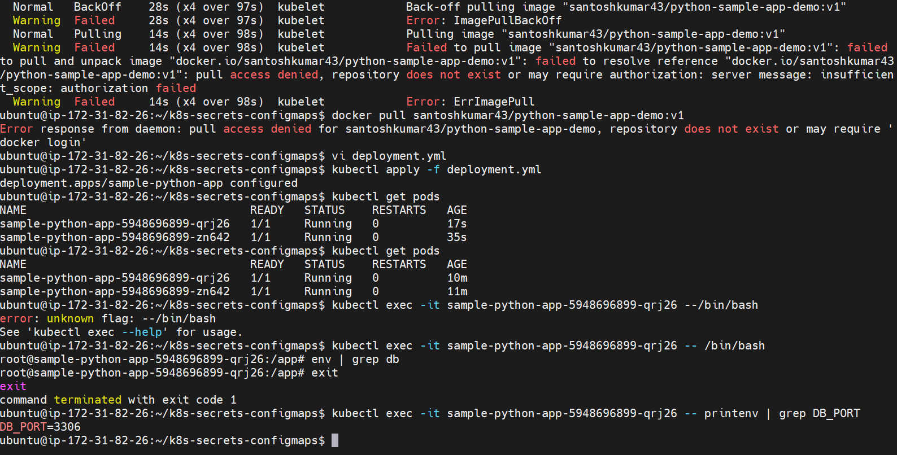
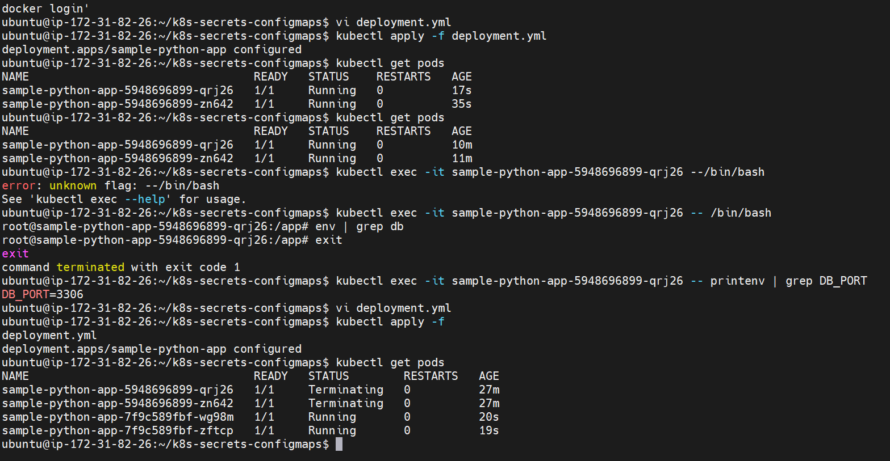
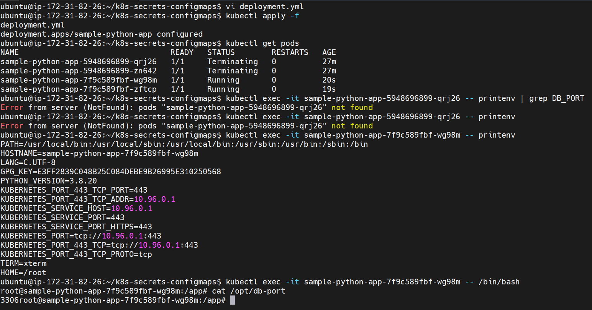
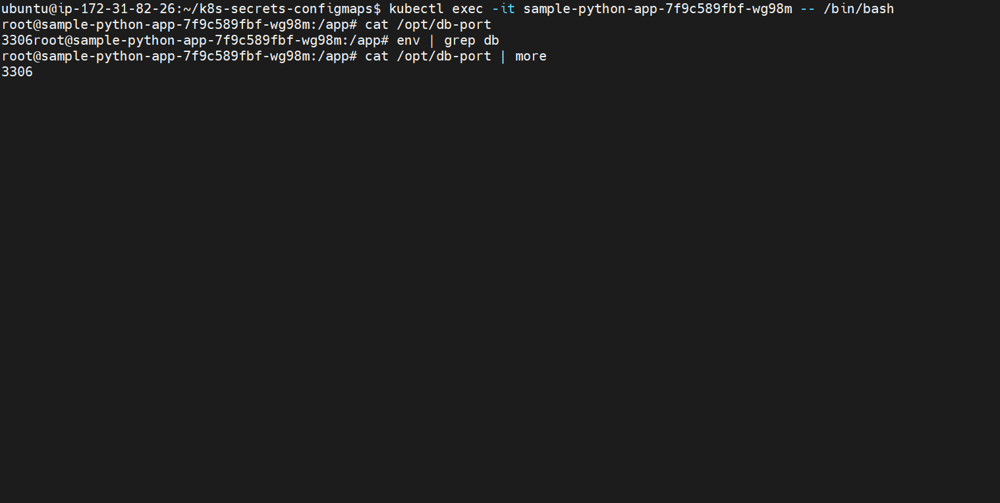
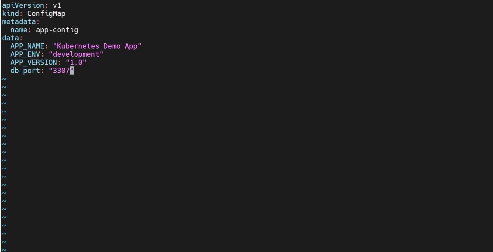
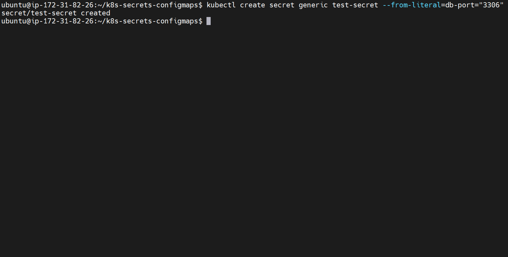
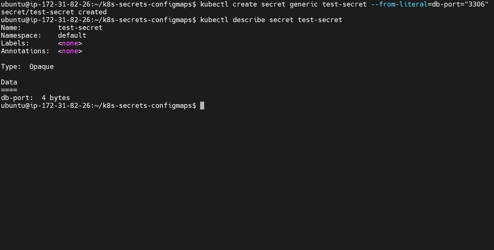

# Kubernetes ConfigMaps & Secrets

Hands-on project on managing application configuration with ConfigMaps and Secrets.

## Approach

1. **Environment variable:** the ConfigMap value was injected with `valueFrom.configMapKeyRef` (`deployment-env.yml`). It is read once, when the container starts.
2. **Volume mount:** the ConfigMap was then mounted as a volume (`deployment-volume.yml`), exposing `db-port` as the file `/opt/db-port`. Updating the ConfigMap changed the file's content without rebuilding the image.

## 1. Troubleshooting ImagePullBackOff

## 2. Applying the Deployment and Checking Pods

## 3. Verifying the Config Value Inside the Pod

## 4. Original Value (3306)

## 5. Updating the ConfigMap (db-port: 3307)

## 6. Updated Value Reflected in the Pod

## 7. Creating a Secret

## 8. Describing the Secret (Value Hidden)

